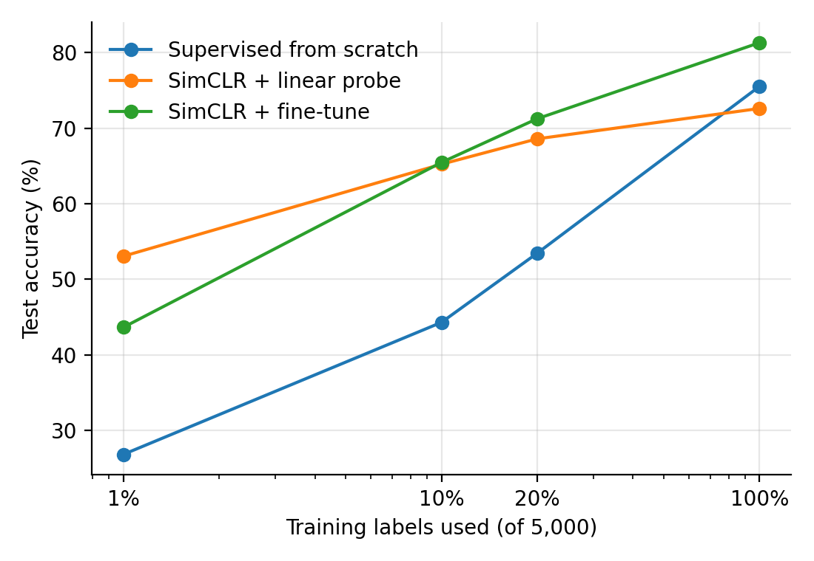
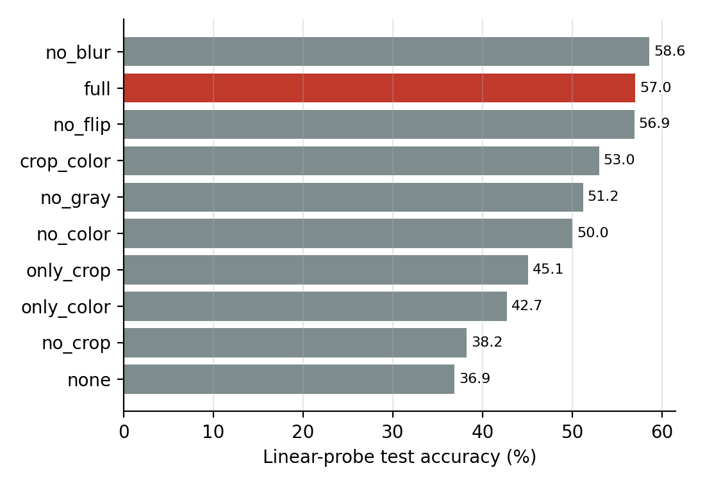
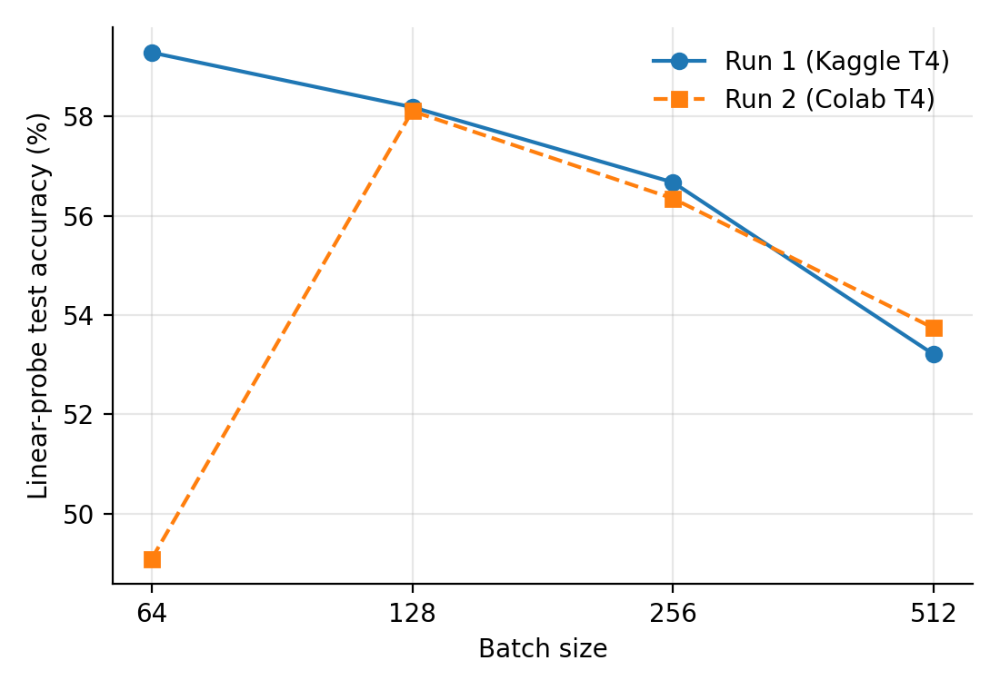

# Self-supervised contrastive pretraining when labels are scarce (SimCLR on STL-10)

Deep Learning project. Team: Shubham Kang, Sandhya Parmar, Nidhi Kumari.

Question: which SimCLR augmentations matter most on a small compute budget, and how much does
pretraining on 100k unlabelled images help a classifier trained on few labels?

See [TASKS.md](TASKS.md) for who does what.

## Setup
```
pip install -r requirements.txt
```
STL-10 downloads automatically into `data/`.
The runs above were done on Kaggle with the launchers in `kaggle/`, `kaggle_eval/`, `kaggle_ablation/` and `kaggle_ablation2/`.

## Reproduce
```
python train_simclr.py --name full --epochs 50 --batch_size 256    # main pretraining (50 epochs, as used for the results)
bash scripts/run_main_eval.sh                                      # supervised vs linear probe vs fine-tune
bash scripts/run_augmentation_ablation.sh                          # augmentation ablation
bash scripts/run_batchsize_ablation.sh                             # batch-size ablation
python make_plots.py                                               # figures in results/
```
New runs append to `results/results.csv`; the final numbers used in the report are in `results/all_results.csv`, and pretraining loss logs are in `results/logs/`.

## Layout
- `src/` augmentations (on/off flags), data and label subsets, ResNet-18 + projection head, NT-Xent loss
- `train_simclr.py` pretraining; `evaluate.py` scratch / linear probe / fine-tune
- `scripts/` experiment runners; `report/` final report `report/report.pdf` (ELCVIA template, source `report/report.tex`; build in `report/` with `tectonic report.tex` or `pdflatex report.tex`)

## Results
STL-10 test accuracy (8,000 images), ResNet-18, one seed. SimCLR pretrained for 50 epochs on the
100k unlabelled images (batch 256, one Kaggle T4, about 3.1 hours).

| Labels used | Supervised from scratch | SimCLR + linear probe | SimCLR + fine-tune |
|---|---|---|---|
| 100% (5,000) | 75.5 | 72.6 | **81.3** |
| 20% (1,000) | 53.4 | 68.6 | **71.2** |
| 10% (500) | 44.3 | 65.2 | **65.5** |
| 1% (50) | 26.8 | **53.1** | 43.6 |



Augmentation and batch-size ablations (20 epochs, 20k images, linear probe at 100% labels):




Random resized crop matters most (removing it: 57.0 to 38.2%), then colour jitter (-7.0) and grayscale (-5.8); flip and blur gave no measurable benefit. Smaller batches did better at a fixed 20 epochs (64: 59.3%, 512: 53.2%). All numbers: `results/all_results.csv`.

Pretrained encoder: `full.pt` (Google Drive: https://drive.google.com/drive/folders/19Jx_VJRAVgrmFSTTiKfxzuYg_Dki9dWL). Place it in `checkpoints/` to rerun `scripts/run_main_eval.sh`.

## Contributions
- Shubham Kang: SimCLR implementation, Kaggle setup, 50-epoch pretraining and six augmentation ablation settings, figures, method, augmentation ablation, discussion and conclusion, report assembly
- Sandhya Parmar: supervised baseline, 1% label fix, linear-probe and fine-tune evaluation and four augmentation ablation settings (run on Kaggle), experimental setup and results sections
- Nidhi Kumari: batch-size ablation runs on Colab, introduction, related work, batch-size section, references, report template

## Reference
Chen et al., A Simple Framework for Contrastive Learning of Visual Representations, ICML 2020. https://arxiv.org/abs/2002.05709
